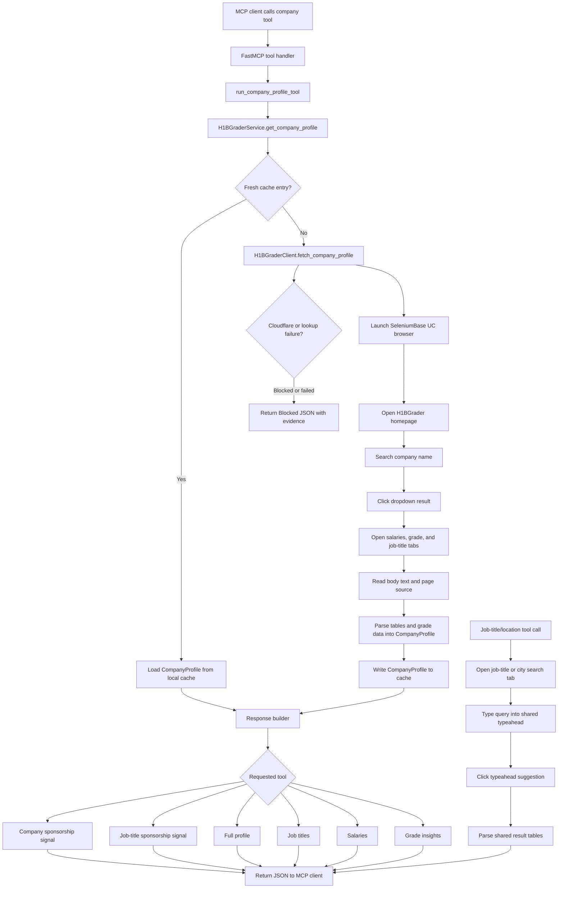

# H1B MCP

[](https://pypi.org/project/h1b-mcp/)
[](https://pypi.org/project/h1b-mcp/)
[](LICENSE)
[](src/h1b_mcp/py.typed)

Live H-1B sponsorship checks for Codex and other MCP-compatible agents.

`h1b-mcp` opens H1BGrader in a real browser, searches for companies, job
titles, and locations, extracts profile tables, and returns normalized
sponsorship signals with structured evidence.

> This is an independent community project. It is not affiliated with,
> authorized by, endorsed by, or sponsored by H1BGrader.

## Features

- Live H1BGrader company, job-title, and location lookup through SeleniumBase UC mode.
- Structured H-1B sponsor signal: `Strong signal`, `Mixed signal`,
  `Weak signal`, `No sponsor`, or `Blocked`.
- Parsed annual LCA approvals and denial counts.
- Parsed annual LCA approval and denial rates.
- Parsed annual USCIS H-1B approvals and denial counts.
- Parsed annual USCIS approval and denial rates.
- Parsed annual H-1B salary maximum, median, average, and minimum.
- Parsed H1BGrader grade, confidence, annual grades, and grade insight cards.
- Parsed latest H-1B job title counts and salary ranges.
- Parsed job-title and location aggregate profiles with top employers, LCA
  trends, approval rates, and salary history.
- Local caches so repeated checks can reuse parsed H1BGrader data.
- Typed Pydantic response models that are easy for agents to consume.
- Browser-block aware behavior that returns `Blocked` instead of inventing a
  sponsor conclusion.

## Included Tools

| Tool | Description | Output |
| --- | --- | --- |
| `check_h1b_sponsorship` | Classify company-level H-1B sponsorship evidence. | Compact signal, profile URL, and evidence. |
| `check_company_job_sponsorship` | Check whether a company has sponsored evidence for a specific job title. | Exact/close/adjacent/company-only signal, matched titles, LCA counts, and salary ranges. |
| `get_company_profile` | Return the full parsed company profile. | Cached profile metadata plus all parsed LCA, USCIS, salary, grade, and job-title data. |
| `get_company_job_titles` | Return sponsored job titles for a company. | Job title, LCA count, max salary, average salary, and minimum salary. |
| `get_company_salaries` | Return annual H-1B salary history for a company. | Fiscal year, max salary, median salary, average salary, and minimum salary. |
| `get_company_grade` | Return H1BGrader grade details for a company. | Latest grade, confidence, annual grades, and grade insight cards. |
| `check_h1b_job_title_sponsorship` | Classify market-level H-1B sponsorship evidence for a job title. | Signal, evidence, latest LCA row, approval rate, salary row, and top employers. |
| `get_h1b_job_title_employers` | Return top H-1B sponsoring employers for a job title. | Employer names and LCA filing counts. |
| `get_h1b_job_title_salary` | Return annual H-1B salary history for a job title. | Fiscal year, max salary, median salary, average salary, and minimum salary. |
| `check_h1b_location_sponsorship` | Classify city-level H-1B sponsorship evidence. | Signal, evidence, latest LCA row, approval rate, salary row, and top employers. |
| `get_h1b_location_employers` | Return top H-1B sponsoring employers for a city. | Employer names and LCA filing counts. |
| `get_h1b_location_salary` | Return annual H-1B salary history for a city. | Fiscal year, max salary, median salary, average salary, and minimum salary. |

## Quick Start

Run the published package with `uvx`:

```bash
uvx h1b-mcp@latest
```

Lookups use SeleniumBase UC mode. The first lookup may download or prepare a
compatible ChromeDriver automatically.

## Codex Setup

Add the server to your Codex MCP config:

```toml
[mcp_servers.h1b]
command = "uvx"
args = ["h1b-mcp@latest"]
env = { UV_HTTP_TIMEOUT = "300" }
tool_timeout_sec = 300
```

Or add it from the CLI:

```bash
codex mcp add h1b --env UV_HTTP_TIMEOUT=300 -- uvx h1b-mcp@latest
```

Restart Codex and check `/mcp` to confirm the server is available.

## Local Development Setup

Install dependencies:

```bash
uv sync
```

Run the server locally:

```bash
uv run h1b-mcp
```

Use a local checkout from Codex before publishing:

```toml
[mcp_servers.h1b]
command = "uv"
args = ["run", "--project", "/path/to/h1b-mcp", "h1b-mcp"]
tool_timeout_sec = 300
```

## Usage

Ask your MCP client to check a company:

```text
Check whether Databricks sponsors H-1B visas.
```

The MCP tool call is:

```python
check_h1b_sponsorship(company_name="Databricks")
```

Example response shape:

```json
{
  "company_query": "Databricks",
  "matched_company": "Databricks Inc",
  "signal": "Strong signal",
  "url": "https://h1bgrader.com/h1b-sponsors/databricks-inc-nokpn1vn04",
  "evidence": [
    "Latest LCA table reports 174 filings in fiscal year 2026, including 173 certified and 0 denied.",
    "Latest non-empty USCIS table row reports 337 approvals and 0 denials in fiscal year 2025.",
    "H1BGrader grade tab shows latest grade A with high confidence.",
    "Job title table includes 56 sponsored title rows."
  ]
}
```

## How It Works

<details>
<summary>View request flow diagram</summary>



</details>

1. A FastMCP tool receives a company-level request.
2. The shared company tool runner creates an `H1BGraderService` and logs progress through the MCP context.
3. The service checks the local company-profile cache for a fresh parsed profile.
4. On cache hit, the cached `CompanyProfile` goes straight to the response builder.
5. On cache miss, the SeleniumBase UC client opens H1BGrader, searches the company, and navigates to the matched profile.
6. The client opens the salaries, grade, and job-title tabs before reading the page body and HTML.
7. Parsers extract LCA, USCIS, salary, grade, grade insight, and job-title data into typed profile models.
8. The service stores the parsed profile locally for later tool calls.
9. The requested tool builds its focused JSON response from the same cached profile data.
10. Job-title and location profile fetches use the same search tab/typeahead flow, then parse and cache the shared result-page tables.

## Signals

| Signal | Meaning |
| --- | --- |
| `Strong signal` | The profile contains recent, structured approval or filing evidence. |
| `Mixed signal` | The profile contains both sponsor and denial/no-sponsor indicators. |
| `Weak signal` | The profile has limited sponsorship evidence. |
| `No sponsor` | H1BGrader indicates the company is not a sponsor or no useful profile data was found. |
| `Blocked` | Browser verification, a site block, timeout, or an unexpected live lookup failure prevented a reliable conclusion. |

## Browser Blocks

H1BGrader may still present human verification, rate limits, or other bot
protection. When that happens, `h1b-mcp` returns a `Blocked` result with a
clear evidence message instead of making a claim from memory.

The browser profile and caches are stored at:

```text
~/.h1b-mcp/browser-profile
~/.h1b-mcp/cache/company-profiles
~/.h1b-mcp/cache/job-title-profiles
~/.h1b-mcp/cache/location-profiles
```

## Current Scope

This project exposes company, job-title, and location tools backed by locally
cached parsed H1BGrader profiles. It does not ship a bundled employer database
or bulk scrape H1BGrader.

## Roadmap

- Company comparison across sponsorship strength, grades, salaries, and titles.
- Broader search tools across H1BGrader-supported job-title and city pages.

## Troubleshooting

| Problem | What to try |
| --- | --- |
| First lookup is slow | Wait for SeleniumBase to prepare ChromeDriver and the browser profile. |
| Tool times out | Increase your MCP client `tool_timeout_sec` to `300`. |
| Response is `Blocked` | Retry later or verify manually on H1BGrader. The server intentionally avoids guessing. |
| Local server cannot start | Run `uv sync`, then retry `uv run h1b-mcp`. |

## Development

Run the normal checks:

```bash
uv run ruff check .
uv run pyright
uv run pytest
uv build
```

Run tests only:

```bash
uv run pytest -q
```

## Versioning

Version bumps use `bumpver`:

```bash
uv run bumpver update --patch --no-fetch
uv lock
```

Use `--minor`, `--major`, or `--set-version 1.2.3` instead of `--patch` when
needed. `bumpver` is configured not to create commits, tags, or pushes.
