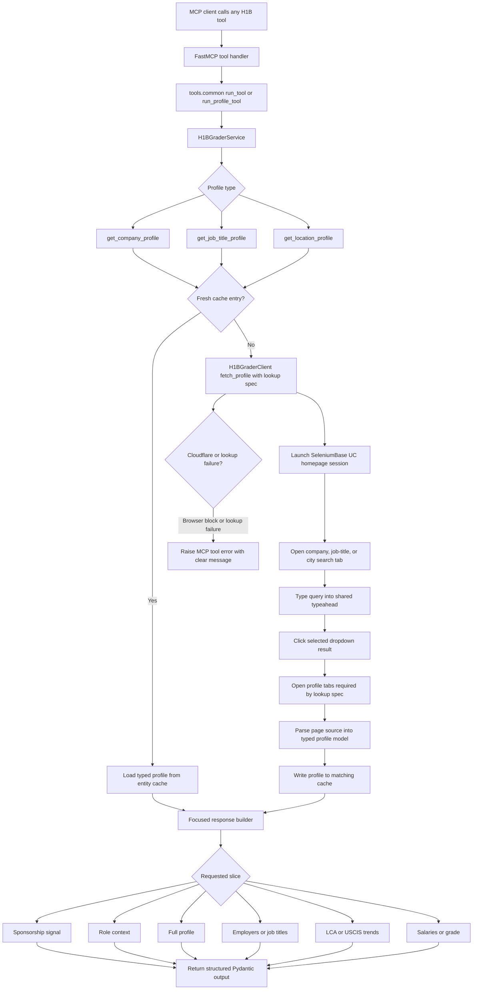

# H1B MCP

[](https://pypi.org/project/h1b-mcp/)
[](https://pypi.org/project/h1b-mcp/)
[](LICENSE)
[](src/h1b_mcp/py.typed)

Live H-1B sponsorship checks for Codex and other MCP-compatible agents.

`h1b-mcp` opens H1BGrader in a real browser, searches for companies, job
titles, and locations, extracts profile tables, and returns normalized
sponsorship signals with structured evidence.

> This is an independent community project. It is not affiliated with,
> authorized by, endorsed by, or sponsored by H1BGrader.

## Features

- Live H1BGrader company, job-title, and location lookup through SeleniumBase UC mode.
- Structured H-1B sponsor signal: `Strong signal`, `Mixed signal`,
  `Weak signal`, or `No sponsor`.
- Parsed annual LCA approvals and denial counts.
- Parsed annual LCA approval and denial rates.
- Parsed annual USCIS H-1B approvals and denial counts.
- Parsed annual USCIS approval and denial rates.
- Parsed annual H-1B salary maximum, median, average, and minimum.
- Parsed H1BGrader grade, confidence, annual grades, and grade insight cards.
- Parsed latest H-1B job title counts and salary ranges.
- Parsed job-title and location aggregate profiles with top employers, LCA
  trends, approval rates, and salary history.
- Local caches so repeated checks can reuse parsed H1BGrader data.
- Typed Pydantic response models that are easy for agents to consume.
- Browser-block aware behavior that raises a clear tool error instead of
  inventing a sponsor conclusion.

## Included Tools

All tools return typed structured content. MCP clients can inspect the full
input and output schemas through `tools/list`.

### Company Tools

| Tool | Use |
| --- | --- |
| `check_h1b_sponsorship` | Classify company-level H-1B sponsorship evidence. |
| `check_company_job_sponsorship` | Check whether a company has sponsored evidence for a specific job title. |
| `get_company_role_sponsorship_context` | Combine company-specific and market-wide H-1B context for a role. |
| `get_company_profile` | Return the full parsed company profile for broader agent reasoning. |
| `get_company_job_titles` | Return sponsored job titles for a company. |
| `get_company_lca_trends` | Return annual company LCA approval and denial trends. |
| `get_company_uscis_trends` | Return annual company USCIS approval and denial trends. |
| `get_company_salaries` | Return annual H-1B salary history for a company. |
| `get_company_grade` | Return H1BGrader grade details for a company. |

### Job Title Tools

| Tool | Use |
| --- | --- |
| `check_h1b_job_title_sponsorship` | Classify market-level H-1B sponsorship evidence for a job title. |
| `get_h1b_job_title_profile` | Return the full parsed job-title profile for broader agent reasoning. |
| `get_h1b_job_title_employers` | Return top H-1B sponsoring employers for a job title. |
| `get_h1b_job_title_lca_trends` | Return annual job-title LCA approval and denial trends. |
| `get_h1b_job_title_salary` | Return annual H-1B salary history for a job title. |

### Location Tools

| Tool | Use |
| --- | --- |
| `check_h1b_location_sponsorship` | Classify city-level H-1B sponsorship evidence. |
| `get_h1b_location_profile` | Return the full parsed city profile for broader agent reasoning. |
| `get_h1b_location_employers` | Return top H-1B sponsoring employers for a city. |
| `get_h1b_location_lca_trends` | Return annual city LCA approval and denial trends. |
| `get_h1b_location_salary` | Return annual H-1B salary history for a city. |

## MCP Client Setup

Prerequisite: [install uv](https://docs.astral.sh/uv/getting-started/installation/) so `uvx` is available.

Use `h1b-mcp` from an MCP-compatible client. The examples below run the
published PyPI package with `uvx`.

Lookups use SeleniumBase UC mode. The first lookup may download or prepare a
compatible ChromeDriver automatically.

### Codex

Add the server to your Codex MCP config:

```toml
[mcp_servers.h1b]
command = "uvx"
args = ["h1b-mcp@latest"]
env = { UV_HTTP_TIMEOUT = "300" }
tool_timeout_sec = 300
```

Or add it from the CLI:

```bash
codex mcp add h1b --env UV_HTTP_TIMEOUT=300 -- uvx h1b-mcp@latest
```

Restart Codex and check `/mcp` to confirm the server is available.

### Claude Desktop and Claude Code

Add the server to your Claude Desktop or Claude Code MCP config. This same
stdio shape also works for many other MCP-compatible clients:

```json
{
  "mcpServers": {
    "h1b": {
      "command": "uvx",
      "args": ["h1b-mcp@latest"],
      "env": {
        "UV_HTTP_TIMEOUT": "300"
      }
    }
  }
}
```

Or add it from Claude Code:

```bash
claude mcp add --env UV_HTTP_TIMEOUT=300 --transport stdio h1b -- uvx h1b-mcp@latest
```

Save the config and fully restart your MCP client so it starts the server.

### VS Code

Add the server through `MCP: Add Server`, or add it to `.vscode/mcp.json`:

```json
{
  "servers": {
    "h1b": {
      "type": "stdio",
      "command": "uvx",
      "args": ["h1b-mcp@latest"],
      "env": {
        "UV_HTTP_TIMEOUT": "300"
      }
    }
  }
}
```

## Local Development Setup

Install dependencies:

```bash
uv sync
```

Run the server locally:

```bash
uv run h1b-mcp
```

Use a local checkout from Codex before publishing:

```toml
[mcp_servers.h1b]
command = "uv"
args = ["run", "--project", "/path/to/h1b-mcp", "h1b-mcp"]
tool_timeout_sec = 300
```

## Usage

Ask your MCP client to check a company:

```text
Check whether Databricks sponsors H-1B visas.
```

The MCP tool call is:

```python
check_h1b_sponsorship(company_name="Databricks")
```

Example response shape:

```json
{
  "company_query": "Databricks",
  "matched_company": "Databricks Inc",
  "signal": "Strong signal",
  "url": "https://h1bgrader.com/h1b-sponsors/databricks-inc-nokpn1vn04",
  "evidence": [
    "Latest LCA table reports 174 filings in fiscal year 2026, including 173 certified and 0 denied.",
    "Latest non-empty USCIS table row reports 337 approvals and 0 denials in fiscal year 2025.",
    "H1BGrader grade tab shows latest grade A with high confidence.",
    "Job title table includes 56 sponsored title rows."
  ]
}
```

## How It Works

<details>
<summary>View request flow diagram</summary>



</details>

1. A FastMCP tool receives a company, job-title, or location request.
2. The shared tool runner creates an `H1BGraderService` and logs progress through the MCP context.
3. The service selects the matching profile cache and checks for a fresh parsed profile.
4. On cache hit, the typed cached profile goes straight to the response builder.
5. On cache miss, the SeleniumBase UC client opens H1BGrader and runs the lookup spec for the requested entity type.
6. The lookup spec selects the correct search tab, typeahead input, expected URL pattern, tabs to open, and parser.
7. Parsers extract the available LCA, USCIS, salary, grade, job-title, or employer data into typed profile models.
8. The service stores the parsed profile in the matching local cache for later tool calls.
9. The requested tool builds a focused Pydantic response from the same cached profile data.
10. Browser blocks, missing suggestions, and unexpected lookup failures are surfaced as MCP tool errors with clear messages.

## Signals

| Signal | Meaning |
| --- | --- |
| `Strong signal` | The profile contains recent, structured approval or filing evidence. |
| `Mixed signal` | The profile contains both sponsor and denial/no-sponsor indicators. |
| `Weak signal` | The profile has limited sponsorship evidence. |
| `No sponsor` | H1BGrader indicates the company is not a sponsor or no useful profile data was found. |

## Browser Blocks

H1BGrader may still present human verification, rate limits, or other bot
protection. When that happens, `h1b-mcp` raises an MCP tool error with a clear
message instead of making a claim from memory.

The browser profile and caches are stored at:

```text
~/.h1b-mcp/browser-profile
~/.h1b-mcp/cache/company-profiles
~/.h1b-mcp/cache/job-title-profiles
~/.h1b-mcp/cache/location-profiles
```

## Current Scope

This project exposes company, job-title, and location tools backed by locally
cached parsed H1BGrader profiles. It does not ship a bundled employer database
or bulk scrape H1BGrader. H-1B source data is released periodically, so cached
profile data is usually useful for repeated analysis rather than minute-by-minute
freshness.

## Troubleshooting

| Problem | What to try |
| --- | --- |
| First lookup is slow | Wait for SeleniumBase to prepare ChromeDriver and the browser profile. |
| Tool times out | Increase your MCP client `tool_timeout_sec` to `300`. |
| Tool reports a browser block or lookup error | Retry later or verify manually on H1BGrader. The server intentionally avoids guessing. |
| Local server cannot start | Run `uv sync`, then retry `uv run h1b-mcp`. |

## Development

Run the normal checks:

```bash
uv run ruff check .
uv run pyright
uv run pytest
uv build
```

Run tests only:

```bash
uv run pytest -q
```

## Project Structure

```text
.
├── .github/workflows/
│   └── publish.yml              # Build, release, and PyPI publish workflow
├── src/h1b_mcp/
│   ├── h1bgrader/               # SeleniumBase browser client and lookup specs
│   ├── matchers/                # Local matching helpers, such as job-title matching
│   ├── models/                  # Pydantic profile, response, and error models
│   ├── parsers/                 # H1BGrader table, grade, summary, and aggregate parsers
│   ├── responses/               # Tool response builders for cached profiles
│   ├── tools/                   # FastMCP tool registration by entity type
│   ├── cache.py                 # Generic disk cache for parsed profiles
│   ├── service.py               # Cache/fetch orchestration layer
│   ├── server.py                # FastMCP server entrypoint
│   └── settings.py              # Runtime paths, timeouts, and cache settings
├── tests/                       # Parser, cache, response, and MCP server tests
├── pyproject.toml               # Package metadata, dependencies, and tool config
└── uv.lock                      # Locked dependency graph
```

## Versioning

Version bumps use `bumpver`:

```bash
uv run bumpver update --patch --no-fetch
uv lock
```

Use `--minor`, `--major`, or `--set-version 1.2.3` instead of `--patch` when
needed. `bumpver` is configured not to create commits, tags, or pushes.
